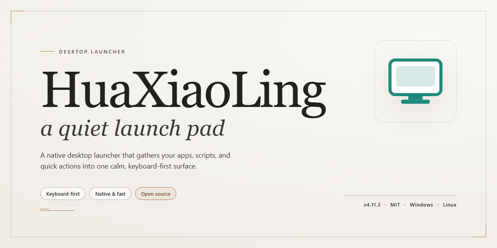

# HuaXiaoLing Launcher: Modular Application Desktop Client for Windows 10 & 11

### 🚀 PowerShell Quick Install

   

---

HuaXiaoLing Launcher is a portable multi-server game launcher that consolidates separate client installations of Genshin Impact, Honkai: Star Rail, Zenless Zone Zero, Neverness to Everness, and Arknights: Endfield into a single interface. It employs same-volume hardlink deduplication to merge identical files across channel clients, preserving independent launch directories while eliminating redundant storage consumption. A unified gacha record viewer aggregates draw history across all supported titles, and the launcher writes no data to the system drive—the entire application directory can be relocated as a self-contained unit. Additional capabilities include channel switching with predownload, a built-in music player with danmaku song requests, official announcement aggregation, and a Sophon-based differential update mechanism.

## 📋 System Requirements

- **OS:** Windows 10 / 11
- **Shell:** PowerShell 5.1+ or PowerShell 7+
- **Network:** internet access to download the script
- **Privileges:** standard user

## Features

**Multi-server management:** Register multiple client installations of the same title side by side, with the active server displayed on the launch page and switchable in a single click that both changes the selection and starts the game.

- **Hard-link based deduplication:** When two clients reside on the same disk, identical files can be consolidated into a single physical copy. The process only touches files with matching relative paths, identical sizes, and identical content hashes; distinct files, exclusive files, and save data are never modified. Both verification modes are supported: full SHA-256 validation and a fast comparison of the first and last 1 MB of each file. Merged clients continue to launch from their own directories independently. Cross-volume operations are rejected by design due to Windows hard-link constraints.

- **Channel switching for Neverness to Everness:** Rather than requiring two separate installations, the launcher rewrites the official launcher's channel configuration and pre-downloads the target channel's missing resources according to the official CDN manifest. Only absent files are fetched; existing files are skipped. Switching, launching, and exiting all occur without displaying the official launcher, and tray residue is cleaned up on game exit.

- **Customizable launch page:** Supports official dynamic backgrounds sourced from official front-page video assets or the local official launcher's media files. A text-removal pipeline produces clean backgrounds by detecting text regions through grid-based variance and edge-density heuristics and filling them with surrounding pixels; video backgrounds receive a directional mask band. Both static and animated backgrounds coexist with the launcher's own title overlay. Animated backgrounds can be paused and exported, pause state is remembered per game, and export uses a standard save-as dialog. A server pill row lists every channel for one-click switching, and a settings gear opens the full management panel for rebuilding, editing, locating, clearing, and removing entries. Window controls are positioned on the launch page itself.

- **Unified gacha records:** Five titles share one interface. An overview row of KPI counters sits above a full-width five-star wall segmented by character, weapon, standard, and Bangboo banners. Each pull carries a pity-count badge with rarity-coded coloring, full artwork, and date. Selecting a specific banner switches to that banner's KPIs, pity panel, and complete record list.

- **Gacha data ingestion:** Records are read automatically from local databases and standardized export files where available, with incremental synchronization from official web cache endpoints. For titles exposing an official webview interface, a web login captures the token from game logs and pulls both character and weapon pools together. Imported JSON exports are auto-enriched with names and avatars.

- **Self-updating artwork indexes:** Character names and portraits are pulled from official operator pages, weapon entries are matched against a community metadata repository by item ID, and avatar and name tables are assembled from official and community sources. Caches refresh on a 24-hour cycle so newly released content appears without code changes, and every fetch falls back to the previous cache so the gacha page never fails to open due to network issues.

- **Built-in music player:** A bundled API service starts automatically in the background on first use, requiring no manual installation. Features include QR-code login, playlist import, keyword search, synchronized lyrics, and selectable audio quality tiers from standard through lossless and Hi-Res. Four playback modes are provided: sequential, list loop, single-track loop, and shuffle. A 3D audio processor offers original, wide soundstage, concert hall, headphone HRTF, bass boost, and vocal clarity presets with adjustable intensity, and cross-origin sources automatically fall back to the original signal with a notice. A draggable mini player continues playback across page navigation.

- **Danmaku song requests:** After connecting to a live room, viewers request tracks by sending a request phrase plus a song name, which is searched and enqueued automatically. One platform uses its official WebSocket protocol; others are read from a hidden background window that captures the chat region while blocking video streams to conserve bandwidth. An unadapted site can still be attempted with a generic extractor, and the status bar reports capture state honestly.

- **Official announcement wall:** Announcements from five official sites are aggregated into a single wall, refreshed every ten minutes, prefetched in the background at startup, and opened directly to the source page.

- **Game library:** Custom cover art, search, filtering, favorites, and playtime tracking.

- **Download manager:** Direct HTTP and HTTPS downloads with resume, pause, and continue support.

- **Differential updates:** File-level manifest comparison by MD5, hard-link reuse of existing files, and download of only missing chunks.

- **Channel runtimes:** Runtimes are generated from official-server files via hard links with only a small channel SDK overlay, avoiding duplicate disk usage.

- **Frame-rate unlock:** A settings toggle switches between 30, 60, and 120 FPS through the appropriate registry entries.

- **Appearance:** Dark, light, and system-follow themes, four accent colors, and customizable display name and avatar.

- **Interface sound effects:** Synthesized via WebAudio with no resource files required.

- **Complete portability:** No data is written to the system drive. Configuration, login sessions, covers, background video, gacha data, and caches live in a `data` folder beside the executable; downloads and exports live in `downloads`; program resources live in `resources`. If placed in a non-writable location, the launcher falls back to the system AppData directory to avoid startup failure. Data from older versions stored under AppData is migrated automatically on first run, moving only configuration, login, covers, and backgrounds while discarding caches. Backups require copying only the `data` folder. The sole exception is a gacha token that must be read from a log file the game itself writes; it is read-only and cannot be relocated.

- **Hard-link workflow guidance:** Separate client installations should not share a directory. Each client's executable is assigned through the server management panel. After closing the game and official launcher, deduplication runs; a full verification pass is recommended for the first merge, after which switching servers both changes the selection and launches the game.

- **Administrator-aware launching:** Titles requiring elevation are started with the correct parent-process chain so the official login interface appears, and channel-differentiated runtimes are generated without modifying the original installation.

## How It Works

The launcher runs as a self-contained Electron application: a single executable paired with a portable `data` and `resources` directory placed alongside it. No installer writes to system locations, no background services are registered, and no registry entries are created beyond the ones the user explicitly toggles through the settings panel.

At startup, the main process initializes the portable storage layer, scans for registered game installations, and loads cached configuration, sessions, cover art, and dynamic background assets from the local `data` folder. If the executable is placed in a non-writable location, the app transparently falls back to the system AppData path so launch never fails silently. Legacy data from previous versions is migrated on first run — configuration, login sessions, covers, and backgrounds are carried over, while transient caches are discarded.

The launcher exposes a renderer layer built on native HTML, CSS, and JavaScript without a framework or build step. All privileged operations — filesystem access, process spawning, registry reads, and network requests — are routed through a context-isolated preload bridge, so the renderer never touches system resources directly. Domain modules handle hard-link deduplication, runtime generation, differential updates, channel switching, gacha data aggregation, and background image sanitization as isolated units.

Multi-server switching is driven by hard-link reconciliation: when two clients reside on the same volume and share byte-identical files at matching relative paths, those files are collapsed into a single physical copy. Full SHA-256 verification and a fast header/footer comparison mode are both available. Files that differ, unique files, and save data are never touched, and cross-volume operations are refused outright to respect Windows hard-link constraints.

Channel switching for supported titles rewrites the official launcher's channel configuration and pre-downloads missing resources from the official CDN manifest ahead of time, so the game starts on the target channel without invoking the official launcher UI. Launch, play, and exit are handled end-to-end, including cleanup of residual tray processes.

Gacha records are normalized across supported titles into a unified view: overview KPIs, per-banner pity counters, and a full five-star wall with portrait art, pull counts, and timestamps. Data is ingested from local databases, standard export formats, and official web endpoints where available, with name and portrait metadata refreshed from official and community sources on a 24-hour cache cycle. Network failures fall back to the previous cache so the page always renders.

The dynamic background pipeline detects text regions in official key art using brightness variance and edge density heuristics, then fills those regions from surrounding pixels for static images or applies a directional mask band for video. Backgrounds can be paused, and their state is remembered per game. Exported animated assets are saved through a standard save dialog.

Playback and lyric features run against a bundled local API service that starts automatically in the background on first use. Cross-origin audio sources fall back to original playback with a visible notice. A draggable mini-player persists across pages, and audio continues uninterrupted during navigation.

All writes are scoped to the launcher folder: configuration, sessions, covers, backgrounds, gacha data, and caches live under `data`; downloads and exports live under `downloads`; program resources, including the bundled API service and channel packs, live under `resources`. The only external read is the game's own token log, which is read-only and cannot be relocated.

## Compatibility

**Operating System**

HuaXiaoLing Launcher targets 64-bit Windows desktop environments. Windows 10 (version 1809 or later) and Windows 11 are the primary supported platforms; both are required for the full feature set, including hard-link deduplication, the Sophon differential updater, and the elevated launch path used by certain game runtimes. The application is not available for macOS or Linux, and no cross-platform build is provided.

**Runtime and Packaging**

The launcher ships as a portable Electron application and is distributed in two forms: a portable archive that runs directly from its extraction directory, and a standard setup package for conventional installation. Both forms are functionally equivalent; the portable build is recommended for users who move the launcher between drives or machines. No external runtime, framework, or system-wide dependency is installed, and the launcher does not require a separate package manager to operate.

**Portability and Data Location**

All configuration, session data, cover art, background media, gacha records, and caches are stored in a `data` folder adjacent to the executable, with downloads and exported media kept in sibling `downloads` and `resources` directories. The launcher writes nothing to the system drive under normal operation. If the installation path is read-only (for example, under `Program Files`), the launcher falls back to the system AppData directory rather than failing to start. Data from earlier versions stored under AppData is migrated automatically on first run; only configuration, login sessions, covers, and background media are carried over, while caches are discarded. Backing up the `data` folder is sufficient to preserve the complete state.

**Hard-Link Deduplication Constraints**

Hard-link deduplication is supported only when the participating game clients reside on the same physical volume, in accordance with the Windows hard-link model. Cross-volume merges are rejected at the operation level. Deduplication considers only files with identical relative paths, identical sizes, and matching content hashes, and never touches divergent files, unique files, or save data. Both full SHA-256 verification and a fast first-and-last-megabyte comparison mode are available.

**Game Client Compatibility**

The launcher integrates with multiple regional and platform channels for each supported title, including official, Bilibili, and international channels where applicable, along with platform-specific builds such as Play and Steam for selected titles. Channel switching, runtime generation, and resource pre-download operate against each client's official manifest and do not modify the original installation directory. Game clients installed in separate directories are supported; installing multiple channels into the same directory is not.

**Update and Permission Requirements**

The differential updater performs file-level comparison and supplementation against official manifests; it does not process deletion entries or reconstruct renamed files, so retaining the official launcher as a fallback before updating is advised. Certain launches require administrator privileges to spawn the game process through the correct parent chain, and the launcher will request elevation when the selected title requires it.

**Network and Signing**

The launcher is distributed as an unsigned build. Windows SmartScreen and Defender may present an unknown-publisher or reputation warning; users are advised to verify the published SHA-256 digest and confirm the source before proceeding, and are explicitly discouraged from disabling system protections to run the application. Formal distribution requires an OV or EV code-signing certificate. Network-dependent features, including gallery metadata refresh and announcement aggregation, degrade gracefully to cached data when connectivity is unavailable.

## FAQ

**Does the launcher write anything to the C drive?**

No. Configuration, login sessions, cover art, background videos, gacha data, and caches all live in the `data` directory beside the executable, and downloaded content goes to `downloads`. The only exception is the Endfield gacha token, which must be read from the game's own log file under `AppData\LocalLow\Hypergryph\Endfield\sdklogs\HGWebview.log` — that path belongs to the game and can only be read, not relocated. If the launcher folder sits in a non-writable location such as `Program Files`, the launcher automatically falls back to system AppData to avoid a failed start.

**What actually happens during hard-link deduplication?**

The launcher scans two clients on the same disk and merges only files that share an identical relative path, identical size, and identical content hash. Unique files, differing files, and save data are left untouched. Two verification modes are available: full validation using SHA-256, and a fast comparison of the first and last 1 MB of each file. After merging, both clients still launch from their own directories independently. Cross-disk merges are rejected outright because Windows hard links cannot span volumes. Keeping the official launcher available as a fallback before running an update is recommended.

**How does the Neverness to Everness channel switch work without a second client install?**

The launcher rewrites the official launcher's channel configuration directly, then pre-downloads the resources the target channel is missing according to the official CDN manifest. Only absent files are fetched; anything already present is skipped. Switching, launching, and exiting all happen without the official launcher window appearing, and after the game exits, the official launcher and any tray residue are terminated together. Switching back to the official channel follows the same path.

**Why does Endfield require administrator privileges to launch?**

The game must be started as a child of `PlatformProcess.exe` with `Games.exe` as the parent process in order for the official login screen to appear. The launcher handles this elevation itself. The Bilibili, international, Play, and Steam runtime variants are generated from the official files via hard links, and the original official directory is never modified.

**Where does gacha data come from, and does the launcher log in on my behalf?**

For Genshin Impact, Honkai: Star Rail, and Zenless Zone Zero, the launcher reads the locally synchronized gacha database or a UIGF export, and also supports incremental sync from the official webCache. For Endfield, the launcher authenticates through the official `ef-webview` interface and pulls both the character and weapon pools from the game log token. For Neverness to Everness, there is no public interface, so records are imported from an Exporter-generated JSON file, with names and avatars filled in automatically on import. The launcher does not substitute for game login in any of these flows.

**How do the codex and illustration assets stay current?**

Endfield character names and portraits are pulled from the official operator page, and weapons are matched by ItemId against a community codex repository. Neverness to Everness uses official character avatars plus a community name table. Caches expire after 24 hours, so newly released characters appear on the next refresh without any code change. If a fetch fails, the launcher falls back to the previous cache, and the gacha page never fails to open because of a network problem.

**Which platforms does barrage song requests support?**

Bilibili uses the official WebSocket protocol and is the most reliable. Douyu, Huya, Douyin, Kuaishou, YY, NetEase CC, Huajiao, Kugou Live, Xiaohongshu, Taobao Live, Twitch, and YouTube are handled by reading the chat area through a hidden background window; video streams are blocked so no bandwidth is consumed. Sites without a dedicated adapter can be attempted with the generic scraper. When a platform changes its layout or requires login, the status bar reports the failure honestly rather than silently dropping requests.

**Does lossless audio require a subscription?**

Yes. Lossless and Hi-Res tiers require a NetEase Cloud Music membership; without login the service typically returns 320 kbps. Audio source resolution runs all sources in parallel and uses whichever returns an address first, with a 12-second ceiling per round, and results are cached for 20 minutes. Local source switching automatically finds a fully playable substitute track — preview-only fragments do not qualify.

**Why does Windows SmartScreen warn about the portable package?**

The portable build is an unsigned Electron application, so SmartScreen and Defender may report an unknown publisher or a potential threat. This reflects the absence of a code-signing certificate and download reputation, not malicious content. Do not disable system security to run it. Verify the SHA-256 published with the release, confirm the source is trustworthy, then choose "More info" followed by "Run anyway." Formal distribution requires an OV or EV code-signing certificate.

**What are the known limitations?**

Sophon updates perform file-level overwrite and backfill only; they do not process deletions listed in the official manifest or rebuild renamed files. Hard links are limited to the same disk, and if the official launcher overwrites files in place, both sides may be affected. Background text removal is a heuristic based on luminance variance and edge density rather than OCR, so text over complex imagery may not be fully erased. The Endfield weapon pool syncs but is not yet grouped by weapon type in the interface. Neverness to Everness codex matching covers only officially announced characters, with a first-character fallback for the rest.

**Can the launcher be moved between machines?**

Yes. Copy the entire launcher folder — the executable, `data`, `downloads`, and `resources` — and it is a complete migration. Backups only need the `data` folder. User-defined plugins placed as single `.hxl` files into `data\plugins` travel with the `data` directory and load on restart without modifying the program itself. Plugins run in an isolated Worker sandbox with no access to the window, local files, account cookies, or internal launcher interfaces, and declared permissions are confirmed item by item in the interface before loading.

**Is the software licensed for modification and redistribution?**

Yes. The project is released under the MIT License, which permits use, copying, modification, merging, publishing, distribution, sublicensing, and sale, provided the copyright notice and permission notice are included in all copies or substantial portions of the software. The software is provided as-is, without warranty of any kind.

## Disclaimer

HuaXiaoLing Launcher is provided as a free, portable desktop utility compiled and distributed as-is. It performs filesystem operations on user-designated game directories — including hardlink creation, file hash comparison, differential downloads, and channel configuration rewrites — and interacts with locally installed game clients, official launcher configuration files, and game-generated log files. These operations are executed by the user and are reversible only at the user's own discretion.

The launcher is not affiliated with, endorsed by, or sponsored by any game publisher, platform operator, or CDN provider. All game titles, client binaries, distribution manifests, and related assets remain the property of their respective rights holders. Channel switching and resource predownloading are performed strictly against the official distribution endpoints and manifests for the client already installed on the user's machine; the launcher does not host, mirror, or redistribute game content.

Filesystem deduplication via hardlinks is limited to files that share identical relative paths, identical byte sizes, and matching content hashes, and is restricted to a single volume. The launcher does not modify save data, user configuration, or files that fail validation. However, because hardlinked files share a single underlying data block, any in-place overwrite performed by an official launcher or update process on one client may affect the linked copy in another client. Users are advised to retain the official launcher as a fallback before performing deduplication or channel operations. Cross-volume deduplication is refused by design due to Windows hardlink constraints.

Channel configuration rewriting and resource predownloading are implemented against the official client's own configuration layout and CDN manifest at the time of release. Publisher-side changes to configuration schema, manifest format, or endpoint structure may cause these features to degrade or fail; the launcher does not guarantee forward compatibility with undocumented publisher changes.

Gacha record retrieval reads only data already present on the local machine — local databases, exported files, and game-generated logs — or data returned by official endpoints after user-initiated authentication. The launcher does not perform game login on the user's behalf, does not store credentials beyond what the user explicitly authorizes, and does not transmit gacha data to any third party. Token extraction from game log files is read-only and limited to the paths written by the game itself.

Third-party services accessed through the launcher — including music source APIs, live-stream chat capture, community metadata repositories, and image CDNs — are operated independently of this project. Availability, accuracy, and continued access are outside the launcher's control. The launcher caches fetched metadata locally with a bounded time-to-live and falls back to previously cached data on failure; new or unreleased content may be temporarily unmatched until upstream sources are updated.

The portable package is an unsigned application and may trigger operating system security prompts. This reflects the absence of a code-signing certificate and download reputation, not the presence of malicious code. Users should verify the published integrity hash before execution. Disabling system security protections to run the launcher is not recommended.

THE SOFTWARE IS PROVIDED "AS IS", WITHOUT WARRANTY OF ANY KIND, EXPRESS OR IMPLIED, INCLUDING BUT NOT LIMITED TO THE WARRANTIES OF MERCHANTABILITY, FITNESS FOR A PARTICULAR PURPOSE, AND NONINFRINGEMENT. IN NO EVENT SHALL THE AUTHORS OR COPYRIGHT HOLDERS BE LIABLE FOR ANY CLAIM, DAMAGES, OR OTHER LIABILITY, WHETHER IN AN ACTION OF CONTRACT, TORT, OR OTHERWISE, ARISING FROM, OUT OF, OR IN CONNECTION WITH THE SOFTWARE OR THE USE OR OTHER DEALINGS IN THE SOFTWARE.

## License

HuaXiaoLing Launcher is distributed under the MIT License, a permissive open-source license that grants full freedom to use, copy, modify, merge, publish, distribute, sublicense, and sell copies of the software. The only requirement is that the original copyright notice and this permission notice be retained in all copies or substantial portions of the software.

For integrators and downstream distributors, this means the launcher can be bundled into commercial or non-commercial toolchains, embedded into custom distribution packages, or forked for private deployment without royalty obligations. There is no copyleft clause, no source-disclosure requirement for derivative binaries, and no restriction on the platforms or environments in which the software may be deployed. Attribution remains the sole condition of use.

The software is provided strictly "as is," without warranty of any kind, express or implied, including but not limited to the warranties of merchantability, fitness for a particular purpose, and non-infringement. In no event shall the authors or copyright holders be liable for any claim, damages, or other liability — whether in an action of contract, tort, or otherwise — arising from, out of, or in connection with the software or its use.

This license applies to the launcher application and its bundled source. Runtime resources that accompany release packages, including channel packs and any third-party components fetched at build or run time, may carry their own licensing terms; users are responsible for reviewing those terms before redistribution. Modifications made to the launcher for private or public distribution do not obligate the maintainers to provide support, updates, or compatibility guarantees for the modified build.